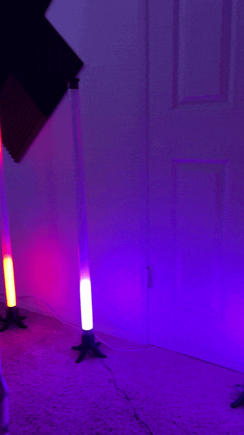

# LED Control Server

A lightweight Flask server that serves a simple web interface for controlling LED animations and settings over a local network. Built for quick prototyping and syncing LED behavior via HTTP + JavaScript.



## 🧩 Prerequisite: D1 Mini Firmware (Required)

**First you must flash the required firmware onto your D1 Mini.**

**➡️ [LED Tube Firmware](https://github.com/CasualCaleb/Ledtube-Firmware)**

The server communicates with the D1 Mini using its companion firmware. Without it, LED control functionality will not work as intended.

## 🚀 Getting Started

### 1. Clone the Repository

```bash
git clone https://github.com/CasualCaleb/ledtube-server.git
cd LEDServer
```

### 2. Set Up the Environment

```bash
python -m venv .venv
source .venv/bin/activate   # On Windows: .venv\Scripts\activate
pip install -r requirements.txt
```

### 3. Run the Server

```bash
python LEDServer.py
```

Then open your browser and navigate to:

http://127.0.0.1:5000

**Note:** Make sure your D1 Mini is running the [LED Tube Firmware](https://github.com/CasualCaleb/Led-Tube-Firmware) before attempting to control your LEDs.

## 🛠 Tech Stack

- Python 3.x
- Flask 3.1
- HTML5 + JavaScript (vanilla)
- Local network communication (extendable with UDP, serial, etc.)

## 📦 Dependencies

See `requirements.txt` for the full list of dependencies.

Core dependency:
- Flask

## 🔗 Related Repositories

- **[LED Tube Firmware](https://github.com/CasualCaleb/Led-Tube-Firmware)** — Required companion firmware for the D1 Mini microcontroller.
